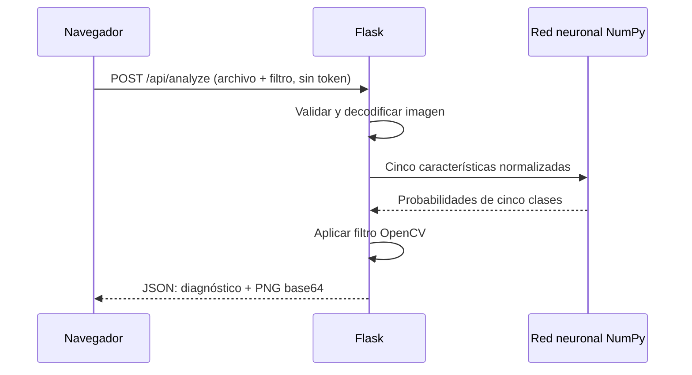

# Autenticación, credenciales y flujo de solicitudes

El repositorio estaba vacío al comenzar. La frase de la actividad sobre explicar autenticación se documenta aquí sobre el código final: **NeonLens no implementa login ni autorización por usuario**. Sus rutas son públicas. No hay contraseñas, JWT, cookies de sesión, refresh tokens ni localStorage de credenciales.

## Componentes

1. `templates/index.html`: interfaz sin formulario de acceso.
2. `static/app.js`, funciones `load` y `analyze`: vista previa local mediante URL de objeto y POST multipart del archivo a `/api/analyze` con `fetch` del mismo origen. No adjunta cabecera Authorization ni token.
3. `app.py`, función `analyze`: valida presencia del archivo, filtro permitido, límite de 8 MB, imagen decodificable y límite de 16 MP. ImageOps corrige orientación; RGB y reducción a 1200 px eliminan metadatos al exportar el nuevo PNG.
4. `vision.features`: extrae cinco señales de una copia de 64×64.
5. `train.predict`: carga solo los pesos numéricos versionados, normaliza, ejecuta capas ReLU y softmax.
6. OpenCV aplica el filtro solicitado. Flask devuelve diagnóstico y PNG en base64. El navegador compara y descarga. No persiste fotos; el proceso retiene temporalmente buffers hasta que se liberan.

`GET /api/metrics` publica evaluación educativa; `GET /health` verifica disponibilidad del modelo; `GET /` entrega la interfaz. `MAX_CONTENT_LENGTH`, errores 400/413 y listas permitidas son validación de entrada, **no autenticación**. No se habilita CORS. Las respuestas incluyen no-store y nosniff. Sin sesión ni acciones persistentes por usuario, no se utiliza token CSRF. El endpoint público puede ser consumido fuera del navegador y no tiene limitación de frecuencia de aplicación.

## Credenciales de infraestructura

GitHub y Render administran por separado sus credenciales de conexión/despliegue. No se copian sus tokens en el código, navegador ni notebook. La aplicación solo lee `PORT`; `PYTHON_VERSION` configura el entorno del proveedor. `.env` está excluido de Git. HTTPS público lo termina Render. No hay secreto de aplicación necesario para esta versión.

Si se añaden galerías privadas, historial o cuentas, se necesitará autenticación real, autorización por recurso, gestión de sesión y almacenamiento por usuario antes de publicar esos datos. El estado actual no ofrece esas funciones.
